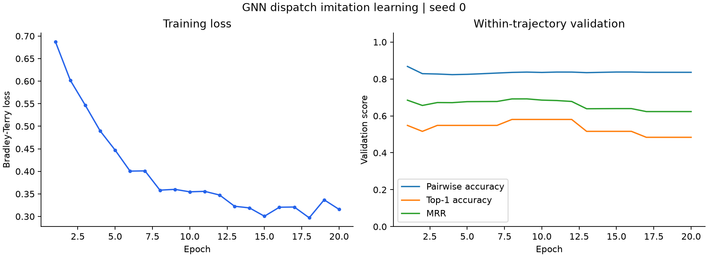
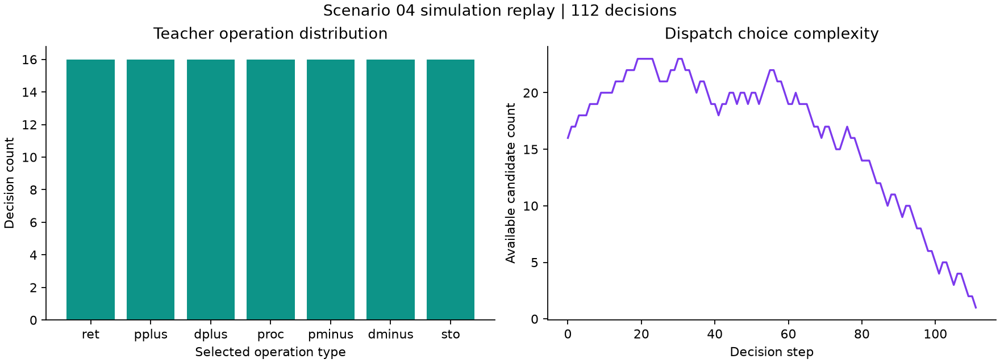

# 디지털 트윈 기반 이상상황 탄력적 대응 프레임워크

## 1. 프로젝트 개요

DN솔루션즈의 공작기계를 포함한 한국전자기술연구원(KETI) SMIC 제조 테스트베드를 대상으로, 생산계획 수립과 이상상황 대응을 연계하는 디지털 트윈 기반 탄력적 생산운영 프레임워크이다. 대상 환경은 CNC 설비, 버퍼, AMR, AS/RS, 셔틀 및 리프터가 연계된 생산·물류 복합 시스템이다.

프레임워크는 P4R 정보관리, 메타휴리스틱 기반 스케줄링, GNN 기반 정책 모델, 디지털 트윈 시뮬레이션 및 오케스트레이터로 구성된다. 동일한 P4R 현재 상태를 계획 수립과 검증의 공통 초기 조건으로 사용하며, 이상상황 발생 이후 현재 상태 동기화–정책 기반 복구 운영–재스케줄링–신규 계획 검증–계획 기반 운영 전환을 연결하여 생산운영의 지속을 지원한다.

본 저장소는 계획 단계의 초기 생산계획 수립·검증과 정책 기반 시뮬레이션 준비를 다룬다. P4R 데이터로부터 메타휴리스틱 초기계획을 생성하고, 의사결정 기록을 이용해 GNN 기반 정책 모델을 학습한 뒤 Visual Components에 탑재한다. 정책 모델은 복구 기간 동안 현재 실행 가능한 작업–자원 후보를 평가하여 단기 생산운영을 지원하는 역할을 한다.

## 2. 처리 흐름

| 단계 | 수행 내용 | 목적 및 역할 |
|---|---|---|
| 시나리오 구성 | JSON의 작업·설비·운반장비·재공 상태를 해석하고 스케줄링 입력으로 변환 | 생산·물류 조건과 자원 제약 정의 |
| 초기계획 생성 | C# 메타휴리스틱으로 작업 순서를 탐색하고 계획을 JSON으로 출력 | 총지연을 줄이는 작업 순서 탐색 |
| VC 계획 적용 | 계획을 VC 구성요소의 속성 및 실행 순서에 반영 | Sequence 모델에서 계획의 실행 과정 확인 |
| 학습 데이터 구성 | 의사결정별 상태·후보·선택 기록을 그래프와 텐서로 변환 | 초기계획의 의사결정을 학습 가능한 형태로 표현 |
| GNN 학습 | PyTorch로 후보 작업의 점수를 학습하고 다음 작업 선택 | 교사 의사결정을 모방하는 작업 선택 정책 구성 |
| VC GNN 배포 | 가중치와 추론 코드를 Rule 모델에 내장하고 추론 결과 비교 | VC에서 사용할 작업 선택 정책의 패키징 및 계산 일치 확인 |
| 시각화 | 학습 손실·검증 지표·공정별 선택 빈도·후보 수 변화 출력 | 학습 과정과 의사결정 데이터의 특성 분석 |

초기계획 통합 실행에서는 GNN을 내장한 Rule 모델을 생성한 뒤, Sequence 모델에 메타휴리스틱 계획을 적용하여 시뮬레이션한다. Sequence 모델은 사전 계획을 실행하며, Rule 모델은 상태에 따른 GNN 작업 선택을 위한 모델이다.

## 3. 코드 및 폴더 구성

| 경로 | 역할 |
|---|---|
| `0_오케스트레이터/` | 초기계획 생성, GNN 학습, VC 모델 적용을 연결하는 C# 플러그인 |
| `0_오케스트레이터/tools/` | GNN 가중치 변환, VC 추론 코드 생성, 모델 내장 및 검증 |
| `1_메타휴리스틱/` | JSON 파싱, 스케줄 탐색, 계획·학습 기록 출력 |
| `2_규칙모델/` | 그래프·후보 피처 구성, PyTorch GNN 학습 및 추론 |
| `3_시나리오/` | 초기계획 생성용 JSON 시나리오 |
| `4_VC모델/` | Sequence 모델과 Rule 모델 템플릿 |
| `data/` | 예제 실행용 의사결정 기록(JSONL)과 공정·자원 구조(INSTANCE) |
| `src/` | Matplotlib 시각화 코드 |
| `results/` | 학습 지표, 추론 예시, 그래프 및 검증 로그 |

주요 진입점은 다음과 같다.

- `AbstractMain.cs`: 초기계획 파이프라인 실행 및 설정
- `ScenarioLoader.cs`: JSON 시나리오 해석
- `VnsProcessAdapter.cs`: 메타휴리스틱 실행 및 결과 연결
- `Synchronization.cs`, `JsonPreprocessing.cs`: 계획을 VC 모델의 속성과 작업 순서로 변환·적용
- `TrainedRuleModelPipeline.cs`: GNN 학습부터 VC Rule 모델 생성까지 연결
- `run_demo.py`: 예제 데이터 기반 학습·추론·시각화
- `run_vc_packaging.py`: 학습 모델의 VC 배포 파일 생성 및 검증

## 4. 실행 방법

### 4.1. 예제 학습·추론·시각화

실행 환경은 Python 3.12이며, 패키지 버전은 `requirements.txt`에 명시되어 있다. 저장소 루트에서 다음 명령을 실행한다.

```powershell
python -m venv .venv
.\.venv\Scripts\python.exe -m pip install -r requirements.txt
.\.venv\Scripts\python.exe run_demo.py
```

포함된 의사결정 기록으로 CPU에서 20 epochs를 학습한다. 검증 쌍승률이 가장 높은 모델을 저장하고, 후보 선택 예시와 분석 그래프를 생성한다.

- `results/model.pt`: 학습된 GNN
- `results/metrics.json`: 학습 손실 및 검증 지표
- `results/predictions.txt`: 후보 점수와 선택 결과
- `results/training.png`: 학습 손실과 검증 지표 변화
- `results/replay.png`: 공정별 선택 빈도와 후보 수 변화

### 4.2. VC 배포 파일 생성

예제 학습 완료 후 실행한다. 이 단계는 VC 설치 없이 수행할 수 있다.

```powershell
.\.venv\Scripts\python.exe run_vc_packaging.py
```

학습 가중치와 순수 Python 추론 코드를 Rule 모델에 내장하여 `results/vc-package/trained-rule.vcmx`를 생성한다. 모델 파일의 구조와 내장 스크립트를 검사하고, PyTorch와 VC용 추론 커널의 점수 및 선택 결과를 비교한다. 결과는 `results/vc-packaging.log`에 저장된다.

### 4.3. 초기계획 및 VC 통합 실행

필요 환경은 Windows, .NET 10 SDK, .NET Framework 4.7.2 개발 도구, Visual Components Premium 4.9 및 해당 SDK DLL이다. Python 환경은 4.1절과 동일하다.

1. 초기계획 엔진을 빌드한다.

   ```powershell
   dotnet build "1_메타휴리스틱/PDP_ASRS_WIP.csproj" -p:HasCplex=false
   ```

2. NuGet CLI로 C# 의존성을 복원한다.

   ```powershell
   nuget restore DT_KETI.sln -PackagesDirectory "0_오케스트레이터/packages"
   ```

3. Visual Studio에서 `DT_KETI.sln`을 빌드한다. VC 설치 위치가 다른 경우 `DT_KETI.csproj`의 `VcInstallDir`를 설정한다.
4. VC 실행 환경의 `PORTFOLIO_ROOT`를 저장소 절대경로로 설정하고, `AbstractMain.cs`의 `EXECUTION_MODE`를 `Initial`로 지정한다.
5. 빌드된 `UX.DT_KETI.dll`을 VC 플러그인으로 배치하고 VC를 실행한다.

기본 입력은 `3_시나리오/scenario_04_P4R_INPUT_CLEAN.json`이다. 초기계획 생성, 학습 기록 출력, GNN 학습(200 epochs), Rule 모델 생성, Sequence 모델의 계획 실행이 순차적으로 수행된다. 실행 결과는 `artifacts/runs/`에 저장된다.

## 5. 시각화

학습 손실과 검증 지표의 변화, 공정별 선택 빈도 및 의사결정 단계별 후보 수를 시각화한다. `run_demo.py` 실행 시 다음 그래프가 생성된다.




